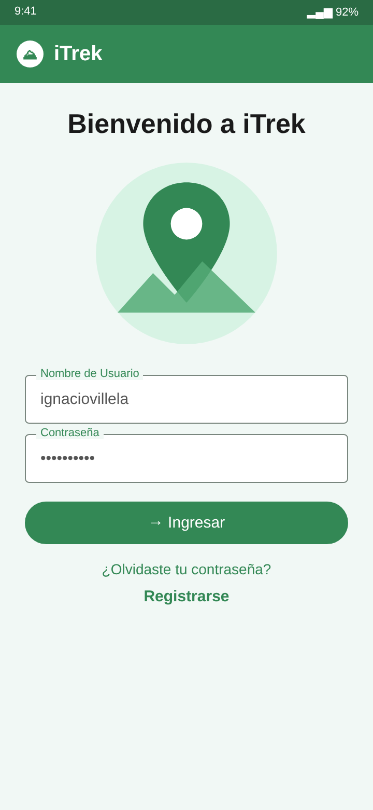
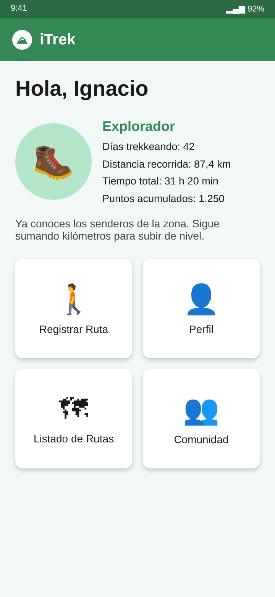
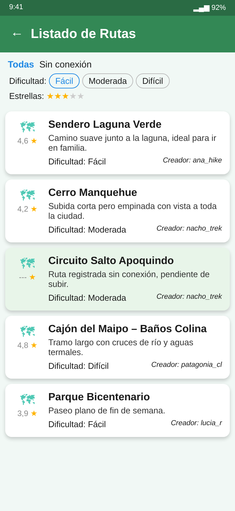
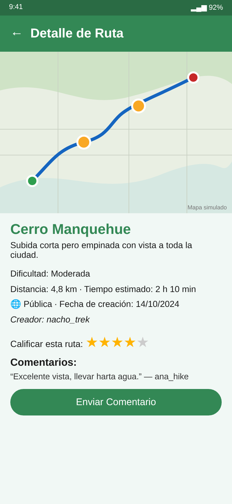

# iTrek (app móvil)

App móvil en **Flutter** para registrar, guardar y compartir rutas de trekking. Graba tu recorrido con GPS, marca puntos clave con foto y descripción, y consulta rutas de otras personas con calificaciones y comentarios. Funciona también **sin conexión**: las rutas se guardan localmente y se suben al servidor cuando quieras.

> Proyecto personal desarrollado entre **septiembre y diciembre de 2024** (235 commits). Backend: [iTrek-back](https://github.com/ignaciovillela/iTrek-back).

🖥️ **Backend (Django REST):** [ignaciovillela/iTrek-back](https://github.com/ignaciovillela/iTrek-back)

## Pantallas

| Ingreso | Inicio | Listado de rutas | Detalle de ruta |
|:--:|:--:|:--:|:--:|
|  |  |  |  |

> Las capturas son **maquetas fieles al diseño del código** (colores del tema, textos y estructura de cada pantalla) con datos de ejemplo; no son capturas de un dispositivo.

## Funcionalidades

- **Registro de rutas con GPS**: seguimiento de ubicación, distancia y tiempo; puntos clave con descripción y foto (cámara o galería).
- **Modo sin conexión**: rutas locales en SQLite (`sqflite`), identificadas en el listado y sincronizables después.
- **Listado con filtros**: por dificultad (Fácil / Moderada / Difícil), estrellas y nombre.
- **Detalle de ruta**: mapa con el trazado (`flutter_map`), valoración, comentarios, publicar/privatizar, compartir con otro usuario y eliminar.
- **Perfil y progreso**: nivel, días trekkeando, distancia, tiempo total y puntos acumulados.
- **Autenticación**: registro, login con token y recuperación de contraseña.
- **Deep links** (`app_links`) y notificaciones locales.

## Stack

Flutter / Dart 3.5 · GetX · flutter_map + latlong2 · geolocator · sqflite · image_picker · permission_handler · flutter_local_notifications · flutter_dotenv.

## Estructura

```
lib/
  main.dart            tema Material 3 verde y arranque
  pages/
    auth/              login, registro, recuperación
    route/             registro, listado, detalle y formulario de rutas
    user/              perfil
    dashboard.dart     inicio con estadísticas y accesos
  helpers/             requests HTTP, base local, mapas, imágenes, deep links
```

## Ejecutar

```bash
flutter pub get
echo "BASE_URL=http://10.0.2.2:8000" > .env   # URL del backend
flutter run
```

Necesita un backend de [iTrek-back](https://github.com/ignaciovillela/iTrek-back) accesible en `BASE_URL`.
